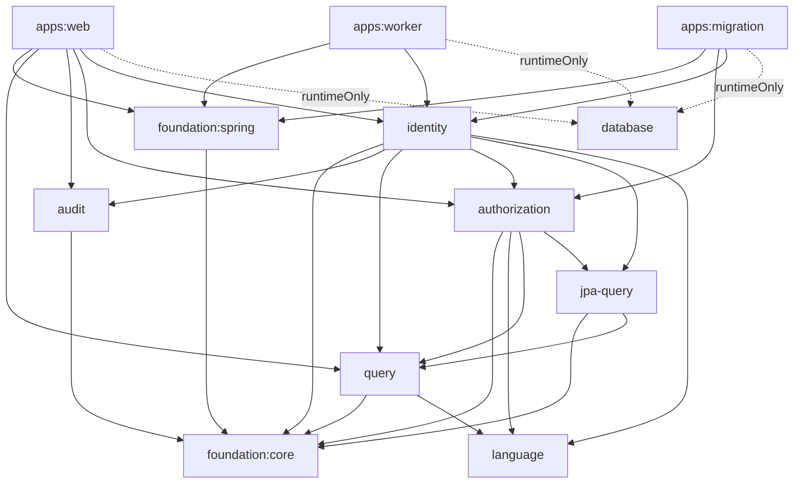

# Server Architecture

Status: Accepted for the architecture migration tracked by #252.

## Decision

Taskmigo server architecture is defined by **Domain-Driven Design + Onion Architecture + Modular Monolith**.

The normative enforcement mechanisms are:

- Gradle project boundaries for meaningful compile-time isolation;
- Spring Modulith for logical module boundaries and deliberately published interfaces;
- ArchUnit for package-level dependency direction and framework-isolation rules.

Hexagonal Architecture is not a normative requirement. Terms such as `port.in`, `port.out`, `adapter.in`, and `adapter.out` may be used locally only when they improve clarity; they must not be required by shared package conventions or by the final architecture tests.

## Executable application boundaries

The server keeps exactly these executable application roots:

```text
server/apps/web
server/apps/worker
server/apps/migration
```

Their responsibilities are runtime composition and framework adaptation:

- `web` owns HTTP/API, OAuth, Spring Security, and web composition;
- `worker` owns background-job runtime and composition;
- `migration` owns migration, installation, provisioning runtime, and its specialized retry/transaction orchestration.

Reusable modules must not depend back on executable applications.

## Final project graph

The final server project graph is responsibility-oriented. Solid arrows below are direct compile/runtime project dependencies; dashed arrows are runtime-only Database dependencies.



Database remains a runtime capability for datasource/JPA/PostgreSQL and migration resources rather than a compile-time dependency bucket for business modules.

## Package conventions

Business bounded contexts use package-by-feature first. Inside a feature, create only responsibilities that actually exist:

```text
<bounded-context>/
  <feature>/
    domain/
    application/
    persistence/
    configuration/
```

Additional responsibility packages such as `integration` or a context-owned transaction implementation are allowed when ownership is explicit.

Do not create empty layers for symmetry. Supporting capabilities such as Language and Query remain simple libraries when they do not have a real domain/application/infrastructure split.

### Domain

Domain packages own business rules, aggregates, entities, value objects, and domain services.

Domain code must not depend on:

- application orchestration;
- persistence or infrastructure implementations;
- framework configuration;
- Spring or JPA;
- executable application code.

### Application

Application packages own use-case orchestration, application services, and application-owned abstractions such as repositories or transaction runners when dependency inversion is required.

Ordinary application code must remain framework neutral and must not depend on:

- concrete persistence implementations;
- Spring Data repositories;
- JPA entities or APIs;
- framework configuration/composition;
- executable application code.

A `package-info.java` may use Spring Modulith metadata to publish a deliberate named interface. That metadata does not make the application implementation framework dependent.

### Persistence and infrastructure

Persistence implementations may depend inward on application-owned abstractions and domain types. JPA and Spring Data dependencies are confined to packages that explicitly own persistence unless a supporting technical capability is intentionally JPA-specific.

### Configuration and composition

Configuration packages may depend inward to wire framework implementations to application contracts. Configuration is an outer responsibility and must not be referenced from domain or ordinary application code.

## Dependency direction

Dependencies point inward:

```text
framework / persistence / configuration
                 |
                 v
            application
                 |
                 v
               domain
```

Removing Hexagonal terminology does not remove dependency inversion. An application service must not depend directly on a concrete JPA repository merely because an `application.port.out` package was removed.

## Cross-context communication

Cross-context dependencies use deliberately published provider-owned contracts or events. Consumers must not reach into another bounded context's private persistence, framework, or implementation packages.

Spring Modulith named interfaces describe business or capability ownership rather than transport direction. Published use-case surfaces use names such as `user-use-cases`, `role-use-cases`, and `object-use-cases`; model/event contracts are published separately when consumers need them.

Executable modules declare only the named interfaces they actually consume. For example, Worker is limited to `identity :: user-use-cases`; it does not receive broad access to Identity or unrelated modules merely because those modules are present on the runtime classpath.

## Gradle dependency exposure

Use `api` only when a library's public contract intentionally exposes types owned by another project. Use `implementation` for implementation details and `runtimeOnly` for runtime capabilities that are not part of the consumer compile contract.

The current exported project dependencies are intentional:

- Identity exports Foundation Core, Query, and Authorization because published Identity use cases expose `OffsetPage`, `QueryPredicate`, and authorization predicate types.
- Authorization exports Foundation Core, Language, and Query because its published contracts expose pagination/query types and compiled Language artifacts.
- Audit exports Foundation Core because its published query contract exposes Foundation pagination types.
- Query exports Foundation Core and Language because those types participate in its public query/compiler model.
- JPA Query exports Foundation Core, Query, and its JPA/Spring Data type system because it is deliberately a JPA-specific supporting capability.
- Foundation Spring exports Foundation Core and the framework APIs that form that technical library's public surface.

All other project dependencies remain `implementation` or `runtimeOnly`. Executable applications depend directly only on modules they compile against; they do not repeat transitive dependencies merely to mirror the runtime graph.

## Foundation and supporting capabilities

Foundation remains a dependency floor and must stay domain neutral. Do not move business repositories, transaction abstractions, or cross-context contracts into Foundation to solve an ownership problem.

Language, Query, Audit, JPA Query, and Database keep structures proportional to their actual responsibilities. A DDD/Onion package hierarchy is not required where it would be artificial.

## Architecture enforcement

`server/testing/architecture` provides the reusable Onion/DDD rule set in `OnionArchitectureRules`.

The reusable baseline enforces:

- framework-neutral, inward-facing domain code;
- framework-neutral application code that cannot depend on persistence/configuration implementations;
- JPA and Spring Data containment in explicit persistence packages;
- reusable modules remaining independent from `web`, `worker`, and `migration`;
- tactical domain/application tests remaining independent from outward persistence and Spring test infrastructure.

Bounded contexts may add stricter rules for published contracts, cross-context access, security, transactions, or optimized query paths.

The active regression fixtures live under the Onion-specific `onionfixtures` namespace and intentionally violate representative rules. Their tests must fail when the corresponding ArchUnit rule is applied, proving that the shared rules detect invalid dependency directions instead of merely documenting them. The retired Hexagonal fixture namespace and `HexagonalOnionRules` helper are not part of the final architecture test surface.

## Consolidated state

The #252 migration no longer carries a compatibility architecture alongside the final model. Retired Hexagonal-only package conventions are protected by capability-specific regression tests where useful, but no shared helper, package alias, or compatibility fixture is required to keep the old topology working.

Internal package compatibility is intentionally not preserved for obsolete architecture paths because Taskmigo is still v0. Provider-owned named interfaces and Gradle project names now describe their final capability ownership.

This architecture migration must not change business behavior, public HTTP/API contracts, authorization semantics, transaction semantics, database behavior, or persistence/query performance.
